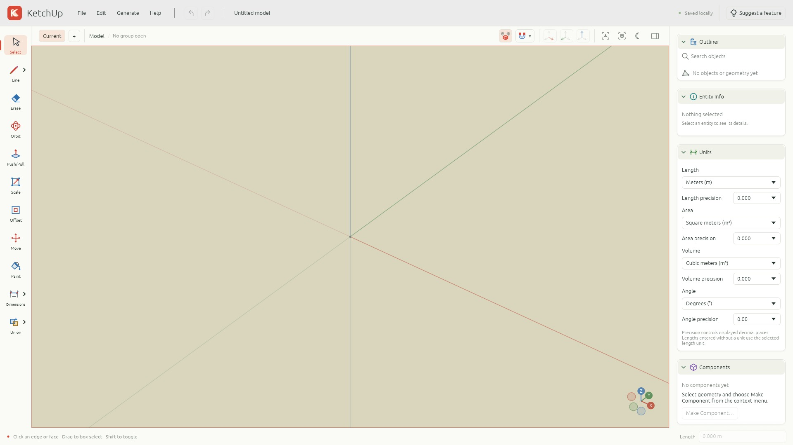

# KetchUp



[](https://ketchup3d.github.io/app/play/)

## Download for desktop

[](https://github.com/Ketchup3D/app/releases/latest/download/io.github.Ketchup3D.Ketchup-win-x64-Setup.exe)
[](https://github.com/Ketchup3D/app/releases/latest/download/io.github.Ketchup3D.Ketchup-osx-arm64-Setup.pkg)
[](https://github.com/Ketchup3D/app/releases/latest/download/io.github.Ketchup3D.Ketchup-linux-x64.AppImage)
[](https://github.com/Ketchup3D/app/releases/tag/v0.6.2)

A small 3D edge and face editor written in Rust. The same editor runs as a native Windows, macOS, or Linux application and in a desktop browser through WebAssembly.

The workspace includes Select, Line, Rectangle, Circle, Polygon, Freehand, Push/Pull, Scale, Offset, Move, Rotate, Paint, Tape Measure, Protractor, Dimensions, a Union flyout, Erase, and Orbit, automatic geometry snapping, filled planar faces, measured lines, full-enclosure box selection, groups and components, a right-click object menu, geometry clipboard, undo/redo, local autosave, and portable `.ketchup` project files. It starts with an empty model. File → Import/Export adds SketchUp `.skp` import and Wavefront `.obj` export. Mobile and cloud storage are outside this version.

## Documentation

This README covers developer installation, building, verification, and deployment.
For instructions on using KetchUp, see the [user documentation](docs/README.md).

## Prerequisites

- Rust 1.95 or newer, installed with rustup; the repository was checked with Rust 1.97.1.
- A C/C++17 compiler for the native SketchUp reader (GCC/Clang on Linux, Xcode Clang on macOS, or MSVC on Windows). Browser builds do not require it.
- A GPU/driver supported by wgpu. The browser prefers WebGPU and falls back to WebGL2.
- On Linux, development libraries for X11/Wayland and xkbcommon. For Debian/Ubuntu: `sudo apt install build-essential pkg-config libx11-dev libxcb1-dev libxkbcommon-dev libwayland-dev libegl1-mesa-dev`.
- On Windows, the MSVC Rust toolchain and Visual Studio C++ build tools.
- On macOS, Xcode Command Line Tools.

## Run on desktop

```sh
cargo run -p ketchup-app
```

On Linux, register the application launcher and icons once after compiling:

```sh
python3 scripts/install_linux_desktop.py
```

This installs into your user data directory (`$XDG_DATA_HOME`, or `~/.local/share`) without root access. GNOME on Wayland uses the application's ID and matching desktop entry to find its icon. Restart KetchUp after installing. The launcher points to `target/debug/ketchup-app`, so later development compilations update the same executable. For a release installation, pass its path: `python3 scripts/install_linux_desktop.py target/release/ketchup-app`. Keep that executable in place, or rerun the installer with its new path if you move it.

## Run in a browser

Install the browser target and Trunk once:

```sh
rustup target add wasm32-unknown-unknown
cargo install --locked trunk
```

From the repository root:

```sh
trunk serve
```

Open <http://127.0.0.1:8080>. Keep the app on the same origin/port to restore the same saved model. No Node.js, JavaScript application framework, or backend is required. Trunk generates the JavaScript needed to load the Rust WebAssembly program.

Development builds use light optimization for application code and stronger optimization for dependencies and the geometry core, on both desktop and WebAssembly. Debug symbols, debug assertions, and overflow checks remain enabled. These optimizations target the cost of menu hovering, scrolling, and rendering in debug mode. The profile takes effect on the next development compilation; changing it recompiles affected dependencies once.

## Compile for distribution

Desktop, on the OS you want to target:

```sh
cargo build -p ketchup-app --release --locked
```

The executable is `target/release/ketchup-app` (`ketchup-app.exe` on Windows). These commands produce executables, not installers or signed application bundles. Native builds should run on the corresponding OS; this project does not configure cross-linkers or signing identities.

### Automated desktop builds

[Build desktop](.github/workflows/build.yml) runs when a `v*` tag is pushed
(for example, `git push origin v0.1.0`). The tag must be a stable `vX.Y.Z`
version matching `[workspace.package].version` in `Cargo.toml`. It builds with
stable Rust and the committed `Cargo.lock`, runs update regression tests, then
packages the app with Velopack:

| Artifact | Platform | Install / run |
|---|---|---|
| `ketchup-windows-x64` | Windows x64 (MSVC) | `*-win-x64-Setup.exe` (per-user installer) |
| `ketchup-macos-arm64` | macOS Apple Silicon | `*-osx-arm64-Setup.pkg` or the portable `.app` zip |
| `ketchup-linux-x64` | Linux x64 (built on Ubuntu 22.04) | `*-linux-x64.AppImage` |

After all three builds succeed, the workflow creates a GitHub Release for the
pushed tag with the prepared release notes, installers, portable packages, full
`.nupkg` updates, one `releases.<platform>.json` feed per OS/architecture, and
`SHA256SUMS`. It validates the packages against their feed hashes and publishes
only after every platform succeeds and all assets have uploaded. Reruns can
replace assets on an unfinished draft; a published version cannot be overwritten.
To ship another update, first add its user-facing notes to
`assets/release-notes.json` (newest version first, keeping previous releases),
then bump the workspace version and lockfile. Validate and preview the notes:

```sh
python3 scripts/desktop_release.py version --tag vX.Y.Z
python3 scripts/desktop_release.py notes --tag vX.Y.Z
```

Refresh the README screenshot by launching an existing desktop executable as
described below. Deploy requests do not run local builds or tests; GitHub Actions
performs the desktop and browser builds, tests, and packaging. Commit and push
the release changes and notes before creating and pushing the matching tag.
Release validation rejects missing or mismatched notes. The same
catalog supplies the GitHub Release description and **Help → Release notes**
in the app. Publishing uses GitHub's automatic token. Signing needs the credentials below.

### Release signing

Without signing secrets, CI produces **unsigned packages for development**.
Before public distribution, configure signing and set the repository Actions
variable `KETCHUP_REQUIRE_SIGNING=true`. This makes packaging fail if Windows or
macOS signing is missing. Checksums detect damaged downloads; they do not
replace publisher signatures. Release access and signing credentials should be
restricted to maintainers. Velopack's [signing guide](https://docs.velopack.io/packaging/signing)
describes certificate/account setup.

For Windows, configure these repository Actions secrets:

| Secret | Value |
|---|---|
| `AZURE_CREDENTIALS` | Azure service-principal credentials JSON for `azure/login`, with permission to sign using the chosen profile |
| `WINDOWS_AZURE_SIGNING` | JSON with `Endpoint`, `CodeSigningAccountName`, and `CertificateProfileName` for Azure Artifact Signing |

The workflow logs into Azure and passes a temporary configuration file to
Velopack's Windows signing integration. The account needs the **Artifact Signing
Certificate Profile Signer** role. Windows SDK signing tools are supplied by
the Windows build runner.

For macOS, export the Developer ID Application and Developer ID Installer
certificates **with their private keys** together into a password-protected
`.p12`, then configure:

| Secret | Value |
|---|---|
| `MACOS_CERTIFICATES_P12` | Base64 of the `.p12`, on one line |
| `MACOS_CERTIFICATE_PASSWORD` | Password protecting the `.p12` |
| `MACOS_SIGN_APP_IDENTITY` | Exact Developer ID Application signing identity |
| `MACOS_SIGN_INSTALL_IDENTITY` | Exact Developer ID Installer signing identity |
| `APPLE_ID` | Apple developer account email |
| `APPLE_TEAM_ID` | Apple developer team ID |
| `APPLE_APP_PASSWORD` | App-specific password for notarization |

CI imports the certificates into a temporary keychain, stores a notarytool
profile, and asks Velopack to sign and notarize the app and installer. It removes
the `.p12` after importing and deletes the keychain even if packaging fails.
Partially configured signing fails instead of silently producing unsigned files.

The Rust dependency, `VPK_VERSION` in the workflow, and the version in
`scripts/desktop_release.py` are pinned together at `1.2.161`. Update them
together. Only the packaging machine needs .NET 8 for the `vpk` CLI; the Rust
app does not require users to install .NET.

Before shipping publicly, install one packaged version on each supported OS,
make a test project, publish a newer version, and verify automatic download,
restart, restored work/file association, the opt-out preference, and failure
recovery. Native update tests run in tag CI; package installation and OS trust
dialogs still need this platform smoke test.

### Browser distribution

```sh
trunk build --release --locked
```

Serve the resulting `dist/` directory with a static web server. Use HTTPS for WebGPU (localhost is also supported). `public_url = "./"` allows serving from a subdirectory. There is no service worker or external asset dependency.

### GitHub Pages website

The presentation page lives in [`site/`](site/index.html). The
[Deploy GitHub Pages](.github/workflows/pages.yml) workflow builds the browser
editor into `dist/site/play/`, adds the landing page and existing branding and
screenshot assets to `dist/site/`, and deploys them together. The main browser
entry point (`index.html`) and `trunk serve` continue to open the editor directly.

To enable publishing for `Ketchup3D/app`:

1. In the repository, open **Settings → Pages → Build and deployment** and set
   **Source** to **GitHub Actions**. See the
   [GitHub Pages setup guide](https://docs.github.com/en/pages/getting-started-with-github-pages/configuring-a-publishing-source-for-your-github-pages-site#publishing-with-a-custom-github-actions-workflow).
2. Push a `v*` tag (for example, `git push origin v0.1.0`), or run
   **Deploy GitHub Pages** from the Actions tab with `main` selected. Version
   tag pushes start the desktop release workflow. Pages builds and deploys the
   same commit only after that workflow succeeds, including publishing the
   desktop release. The updated Pages workflow must be on the default branch
   for this automatic trigger to work. Ordinary branch pushes do not trigger
   either workflow.
3. After the deployment succeeds, the landing page is at
   <https://ketchup3d.github.io/app/> and its **Try in browser** links open
   <https://ketchup3d.github.io/app/play/>. The workflow's environment link shows
   the actual URL if a custom domain is configured.

All local page and editor asset links are relative, so the same package supports
the repository path or a custom domain. GitHub Pages supplies HTTPS. The editor
uses browser-local autosave; visitors should download `.ketchup` projects they
want to keep. GitHub Pages is not cloud model storage.

The landing page includes a canonical URL, Open Graph image metadata, and a
large-image Twitter/X card using the editor screenshot. During deployment,
the workflow sets these absolute URLs from the GitHub Pages configuration,
including a configured custom domain. Social previews require the deployed
public HTTPS page and image; the local preview URL cannot be fetched by social
networks.

## Development and verification

Refresh the README screenshot from an existing desktop executable:

```sh
python3 -B scripts/capture_readme_desktop.py
```

On Linux, this requires X11 or XWayland, ImageMagick's `import` command, and
Python Pillow. The script selects the newest existing executable from the native
release and debug output directories; `--binary /path/to/ketchup-app` selects one
explicitly. It launches the desktop app in an isolated temporary profile, loads
[`assets/examples/Example.ketchup`](assets/examples/Example.ketchup) with its saved
camera and display settings, dismisses open dialogs and popups, captures the
settled window at 1920 × 1080, and updates `assets/screenshots/ketchup.jpg` and its
README link. Visually verify that no modal remains open before using the image.
It never compiles the app, runs tests, or starts benchmarks. The screenshot
reflects the existing executable; a missing executable is reported without
building one.

```sh
cargo check --workspace --locked
cargo check --workspace --target wasm32-unknown-unknown --locked
cargo test --workspace --locked
```

The vendored SketchUp reader, adapter, and browser shortcut handling can also be tested without compiling the application:

```sh
node --test scripts/test_skp_import.cjs
node --test scripts/test_web_shortcuts.cjs
```

An optional offscreen GPU test renders the actual UI and custom viewport to PNGs without opening a window:

```sh
cargo test -p ketchup-app gpu_renders_empty_and_modeled_workspace --locked -- --ignored --nocapture
```

Snapshots appear in `target/qa/`. This test requires a working native GPU adapter. Normal tests cover document validation, geometry, inference, camera math, selection, undo/redo, and synthetic keyboard/pointer interactions through egui.

Run the repeatable CPU interaction benchmarks explicitly (10/100-face drawing,
10/100-object Move, a 4,096-face imported model, axes on/off with 512 groups,
and 256/1,024 shadow casters over a large receiving face):

```sh
cargo test -p ketchup-app --locked --config 'profile.test.package.ketchup-app.opt-level=2' --config 'profile.test.package.ketchup-core.opt-level=2' workload_benchmark -- --ignored --nocapture --test-threads=1
```

These settings optimize application geometry and rendering code while retaining
the existing test dependencies. Timings exclude model construction and GPU
presentation; compare runs on the same machine without other CPU-heavy work.
The shadow workload reports regeneration after sun changes and CPU mesh/edge
rendering separately.
The normal suite also exercises all 22 tools through interrupted gestures,
focus loss, resizing, and document reload, plus display styles and effects.

For a sequential feature audit, including the normally ignored GPU comparisons
and per-tool CPU workloads, run:

```sh
python3 scripts/run_feature_audit.py
```

This uses an isolated temporary autosave directory and writes the feature
checklist, individual test results, GPU comparisons, timings, command logs, and
remaining platform checks to `target/qa/feature-audit/report.txt` and
`report.json`. Every display field has an independent before/after GPU case;
normal interaction tests click the individual toggles, face-style choices,
color pickers, paint swatches, and project confirmation buttons.

Verified during implementation: native Linux and browser WASM Cargo checks; core and UI interaction tests; offscreen Vulkan rendering of empty, modeled, and compact workspaces. Windows/macOS execution, browser startup, and runtime WebGPU/WebGL2 fallback still require platform smoke testing. Production builds and hosted deployment were not run.

## Layout

- `crates/ketchup-core`: double-precision document geometry, planar face discovery/triangulation, inference, picking, camera, tool definitions, and bounded history. It has no GUI or GPU dependencies.
- `crates/ketchup-app`: egui workspace, gesture routing, local persistence, native/browser launchers, and the wgpu/WGSL edge renderer. Model coordinates remain independent of GPU resources.
- `index.html` and `Trunk.toml`: static browser host and WASM development configuration.

The viewport uses depth-tested filled triangles and antialiased triangle strips for consistent edge widths, CPU projection/clipping, and the same shader and editor behavior on every target. Rendering is event-driven rather than a continuous idle loop.

### Account server

Google login and account sessions are provided by the separate Ketchup Server
repository at `/home/dcoulombe/dev/ketchup-server`. See its `README.md` for OAuth
configuration and startup instructions.

The account server is deployment configuration, with no address field in the app.
Launch the desktop app with `ketchup-app --server-url https://accounts.example.com`
or `cargo run -p ketchup-app -- --server-url http://localhost:8081`.
Both `--server-url URL` and `--server-url=URL` are supported.

Alternatively, copy `.env.example` to `.env` in the workspace root and set
`KETCHUP_SERVER_URL`. The example uses port 8080 for the local Web client through
Trunk; for native-only development, use port 8081. Builds embed this value for desktop and Web; changing `.env`
causes Cargo to refresh it on the next build. You can also supply it directly:

```sh
KETCHUP_SERVER_URL=https://accounts.example.com cargo build -p ketchup-app
KETCHUP_SERVER_URL=https://accounts.example.com trunk build --release
```

Desktop precedence is launch argument, runtime `KETCHUP_SERVER_URL`, `.env` in the
current working directory, then the compiled value. Web uses the compiled value.
There is no implicit server address; without configuration the modeling app runs
with the account avatar, its separator, and the login dialog hidden. Saved user preferences
cannot override the server address.

For local desktop development, use `http://localhost:8081`. For the local Web
client, compile with `KETCHUP_SERVER_URL=http://localhost:8080` to use the
`Trunk.toml` account proxies to the server on port 8081. These proxies use
`no_redirect = true` so Google login redirects reach the browser. Restart
`trunk serve` after changing proxy configuration. Other browser deployments
need a same-origin reverse proxy or the server's explicitly configured CORS and
compatible cookie policies. Use HTTPS outside localhost.

`.env` supports `KETCHUP_SERVER_URL=value`, single/double quoted values, optional
`export`, and trailing comments. It is ignored by Git; do not put secrets in the
URL because Web builds expose it to the browser.
