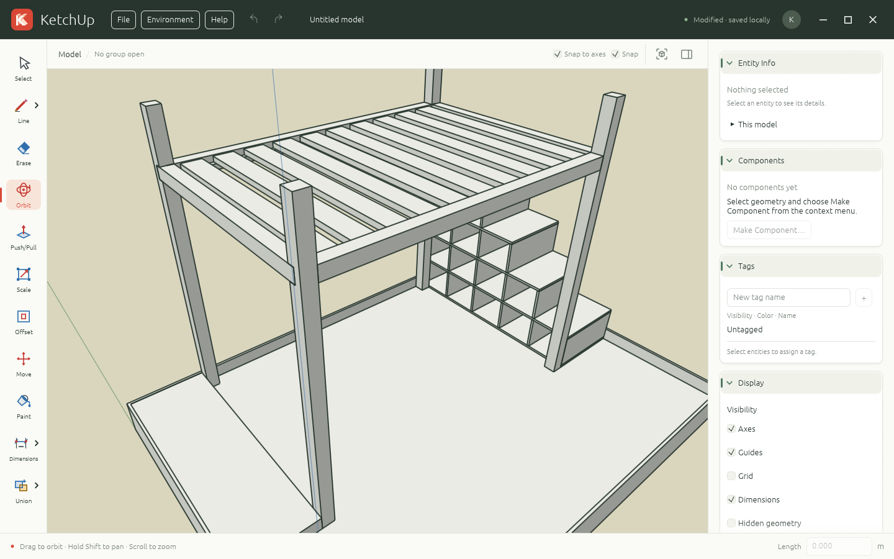

# KetchUp



[](https://ketchup3d.github.io/app/play/)

A small 3D edge and face editor written in Rust. The same editor runs as a native Windows, macOS, or Linux application and in a desktop browser through WebAssembly.

The workspace includes Select, Line, Rectangle, Circle, Polygon, Freehand, Push/Pull, Scale, Offset, Move, Paint, Tape Measure, Protractor, Dimensions, a Union flyout, Erase, and Orbit, automatic geometry snapping, filled planar faces, measured lines, full-enclosure box selection, groups and components, a right-click object menu, geometry clipboard, undo/redo, local autosave, and portable `.ketchup` project files. It starts with an empty model. File → Import/Export adds SketchUp `.skp` import and Wavefront `.obj` export. Mobile and cloud storage are outside this version.

## Prerequisites

- Rust 1.95 or newer, installed with rustup; the repository was checked with Rust 1.97.1.
- A C/C++17 compiler for the native SketchUp reader (GCC/Clang on Linux, Xcode Clang on macOS, or MSVC on Windows). Browser builds do not require it.
- A GPU/driver supported by wgpu. The browser prefers WebGPU and falls back to WebGL2.
- On Linux, development libraries for X11/Wayland and xkbcommon. For Debian/Ubuntu: `sudo apt install build-essential pkg-config libx11-dev libxcb1-dev libxkbcommon-dev libwayland-dev libegl1-mesa-dev`.
- On Windows, the MSVC Rust toolchain and Visual Studio C++ build tools.
- On macOS, Xcode Command Line Tools.

## Run on desktop

```sh
cargo run -p ketchup-app
```

On Linux, register the application launcher and icons once after compiling:

```sh
python3 scripts/install_linux_desktop.py
```

This installs into your user data directory (`$XDG_DATA_HOME`, or `~/.local/share`) without root access. GNOME on Wayland uses the application's ID and matching desktop entry to find its icon. Restart KetchUp after installing. The launcher points to `target/debug/ketchup-app`, so later development compilations update the same executable. For a release installation, pass its path: `python3 scripts/install_linux_desktop.py target/release/ketchup-app`. Keep that executable in place, or rerun the installer with its new path if you move it.

## Run in a browser

Install the browser target and Trunk once:

```sh
rustup target add wasm32-unknown-unknown
cargo install --locked trunk
```

From the repository root:

```sh
trunk serve
```

Open <http://127.0.0.1:8080>. Keep the app on the same origin/port to restore the same saved model. No Node.js, JavaScript application framework, or backend is required. Trunk generates the JavaScript needed to load the Rust WebAssembly program.

## Compile for distribution

Desktop, on the OS you want to target:

```sh
cargo build -p ketchup-app --release --locked
```

The executable is `target/release/ketchup-app` (`ketchup-app.exe` on Windows). These commands produce executables, not installers or signed application bundles. Native builds should run on the corresponding OS; this project does not configure cross-linkers or signing identities.

### Automated desktop builds

[Build desktop](.github/workflows/build.yml) runs when a `v*` tag is pushed
(for example, `git push origin v0.1.0`). The tag must be a stable `vX.Y.Z`
version matching `[workspace.package].version` in `Cargo.toml`. It builds with
stable Rust and the committed `Cargo.lock`, runs update regression tests, then
packages the app with Velopack:

| Artifact | Platform | Install / run |
|---|---|---|
| `ketchup-windows-x64` | Windows x64 (MSVC) | `*-win-x64-Setup.exe` (per-user installer) |
| `ketchup-macos-arm64` | macOS Apple Silicon | `*-osx-arm64-Setup.pkg` or the portable `.app` zip |
| `ketchup-linux-x64` | Linux x64 (built on Ubuntu 22.04) | `*-linux-x64.AppImage` |

After all three builds succeed, the workflow creates a GitHub Release for the
pushed tag with the prepared release notes, installers, portable packages, full
`.nupkg` updates, one `releases.<platform>.json` feed per OS/architecture, and
`SHA256SUMS`. It validates the packages against their feed hashes and publishes
only after every platform succeeds and all assets have uploaded. Reruns can
replace assets on an unfinished draft; a published version cannot be overwritten.
To ship another update, first add its user-facing notes to
`assets/release-notes.json` (newest version first, keeping previous releases),
then bump the workspace version and lockfile. Validate and preview the notes:

```sh
python3 scripts/desktop_release.py version --tag vX.Y.Z
python3 scripts/desktop_release.py notes --tag vX.Y.Z
```

Commit and push the release changes and notes before creating and pushing the
matching tag. Release validation rejects missing or mismatched notes. The same
catalog supplies the GitHub Release description and **Help → Release notes**
in the app. The modal works offline, opens on the latest release, and lets you
browse every release using the version picker or **Newer** / **Older** buttons.
On the first launch of a new version, the release notes open automatically if
you haven't viewed them yet. The last viewed release version is saved immediately
across app restarts and browser reloads, so the modal appears automatically only
once per release. You can reopen it at any time from **Help → Release notes**.

Download the installer or AppImage from [Releases](https://github.com/Ketchup3D/app/releases).
Workflow artifacts are also available on the run's summary page for 14 days.
On Linux, keep the AppImage in a user-writable location, run `chmod +x` on it,
and launch it. AppImage mounting may require your distro's FUSE 2 compatibility
package; the GPU/display runtime requirements above still apply. Do not extract
the AppImage or run a bare executable if you want automatic updates.
Publishing uses GitHub's automatic token. Signing needs the credentials below.

### Automatic desktop updates

The packaged app checks public GitHub Releases in the background at most once
every 24 hours, including during long editor sessions. It downloads newer
versions for its own OS/architecture and verifies package size and checksums.
Full packages are published initially; delta packages are not required. No
update server, end-user GitHub login, or embedded GitHub token is needed.

**Help → Check for updates…** bypasses the daily limit and opens the update
window. That window also controls automatic checking/downloading. Disabling it
stops future automatic checks; a check already in progress may finish, and an
already downloaded update will still install on the next launch. Failed checks
leave the app usable and can be retried manually. The **Update ready** button
appears after a download completes. Installation happens on the next launch,
or through **Restart now**. KetchUp does not force a restart during editing.

Restart now offers to save modified work as a `.ketchup` file, or keep it in
local recovery. It saves the model and its project-file association before
closing; a save failure prevents restart. Finish drawing/modeling previews
before restarting. Autosave, update preferences, and restart information stay
in the existing application data directory outside the installed application.
`KETCHUP_DATA_DIR` redirects them for testing. Browser builds do not include
Velopack; development builds and unpackaged executables do not contact the
update service.

Users of older bare executables must manually install one updater-enabled
release. Subsequent releases update through Velopack. GitHub's unauthenticated
API limits apply, so networks with many users behind one IP may need retries;
the update source can later move to a static HTTPS feed.

### Release signing

Without signing secrets, CI produces **unsigned packages for development**.
Before public distribution, configure signing and set the repository Actions
variable `KETCHUP_REQUIRE_SIGNING=true`. This makes packaging fail if Windows or
macOS signing is missing. Checksums detect damaged downloads; they do not
replace publisher signatures. Release access and signing credentials should be
restricted to maintainers. Velopack's [signing guide](https://docs.velopack.io/packaging/signing)
describes certificate/account setup.

For Windows, configure these repository Actions secrets:

| Secret | Value |
|---|---|
| `AZURE_CREDENTIALS` | Azure service-principal credentials JSON for `azure/login`, with permission to sign using the chosen profile |
| `WINDOWS_AZURE_SIGNING` | JSON with `Endpoint`, `CodeSigningAccountName`, and `CertificateProfileName` for Azure Artifact Signing |

The workflow logs into Azure and passes a temporary configuration file to
Velopack's Windows signing integration. The account needs the **Artifact Signing
Certificate Profile Signer** role. Windows SDK signing tools are supplied by
the Windows build runner.

For macOS, export the Developer ID Application and Developer ID Installer
certificates **with their private keys** together into a password-protected
`.p12`, then configure:

| Secret | Value |
|---|---|
| `MACOS_CERTIFICATES_P12` | Base64 of the `.p12`, on one line |
| `MACOS_CERTIFICATE_PASSWORD` | Password protecting the `.p12` |
| `MACOS_SIGN_APP_IDENTITY` | Exact Developer ID Application signing identity |
| `MACOS_SIGN_INSTALL_IDENTITY` | Exact Developer ID Installer signing identity |
| `APPLE_ID` | Apple developer account email |
| `APPLE_TEAM_ID` | Apple developer team ID |
| `APPLE_APP_PASSWORD` | App-specific password for notarization |

CI imports the certificates into a temporary keychain, stores a notarytool
profile, and asks Velopack to sign and notarize the app and installer. It removes
the `.p12` after importing and deletes the keychain even if packaging fails.
Partially configured signing fails instead of silently producing unsigned files.

The Rust dependency, `VPK_VERSION` in the workflow, and the version in
`scripts/desktop_release.py` are pinned together at `1.2.161`. Update them
together. Only the packaging machine needs .NET 8 for the `vpk` CLI; the Rust
app does not require users to install .NET.

Before shipping publicly, install one packaged version on each supported OS,
make a test project, publish a newer version, and verify automatic download,
restart, restored work/file association, the opt-out preference, and failure
recovery. Native update tests run in tag CI; package installation and OS trust
dialogs still need this platform smoke test.

### Browser distribution

```sh
trunk build --release --locked
```

Serve the resulting `dist/` directory with a static web server. Use HTTPS for WebGPU (localhost is also supported). `public_url = "./"` allows serving from a subdirectory. There is no service worker or external asset dependency.

### GitHub Pages website

The presentation page lives in [`site/`](site/index.html). The
[Deploy GitHub Pages](.github/workflows/pages.yml) workflow builds the browser
editor into `dist/site/play/`, adds the landing page and existing branding and
screenshot assets to `dist/site/`, and deploys them together. The main browser
entry point (`index.html`) and `trunk serve` continue to open the editor directly.

To enable publishing for `Ketchup3D/app`:

1. In the repository, open **Settings → Pages → Build and deployment** and set
   **Source** to **GitHub Actions**. See the
   [GitHub Pages setup guide](https://docs.github.com/en/pages/getting-started-with-github-pages/configuring-a-publishing-source-for-your-github-pages-site#publishing-with-a-custom-github-actions-workflow).
2. Push a `v*` tag (for example, `git push origin v0.1.0`), or run
   **Deploy GitHub Pages** from the Actions tab with `main` selected. Version
   tag pushes start the desktop release workflow. Pages builds and deploys the
   same commit only after that workflow succeeds, including publishing the
   desktop release. The updated Pages workflow must be on the default branch
   for this automatic trigger to work. Ordinary branch pushes do not trigger
   either workflow.
3. After the deployment succeeds, the landing page is at
   <https://ketchup3d.github.io/app/> and its **Try in browser** links open
   <https://ketchup3d.github.io/app/play/>. The workflow's environment link shows
   the actual URL if a custom domain is configured.

All local page and editor asset links are relative, so the same package supports
the repository path or a custom domain. GitHub Pages supplies HTTPS. The editor
uses browser-local autosave; visitors should download `.ketchup` projects they
want to keep. GitHub Pages is not cloud model storage.

The landing page includes a canonical URL, Open Graph image metadata, and a
large-image Twitter/X card using the editor screenshot. During deployment,
the workflow sets these absolute URLs from the GitHub Pages configuration,
including a configured custom domain. Social previews require the deployed
public HTTPS page and image; the local preview URL cannot be fetched by social
networks.

## Controls

| Action | Control |
|---|---|
| New project | File → New project; Ctrl/Command N |
| Open project | File → Open; Ctrl/Command O |
| Save project | File → Save; Ctrl/Command S |
| Save project as | File → Save As; Ctrl/Command Shift S |
| Import SketchUp geometry | File → Import/Export → Import SketchUp (.skp) |
| Export OBJ geometry | File → Import/Export → Export Wavefront OBJ (.obj) |
| Select | Space; click an edge or filled face, Shift-click toggles |
| Box selection | Drag in any direction; selects only fully enclosed edges, faces, dimensions, and groups/components |
| Select all visible entities | Ctrl/Command A, outside text fields |
| Object actions | Right-click geometry or empty model space |
| Edit group/component | Double-click; repeat for nested objects |
| Leave editing level | Escape, double-click outside, or use the editing breadcrumb |
| Cut / Copy / Paste | Ctrl/Command X / C / V; Paste previews at the pointer, click to place |
| Paste in place | Ctrl/Command Shift V; retains the copied coordinates |
| Automatic geometry snapping | Snap checkbox beside Grid; enabled by default and saved with the model |
| Automatic axis snapping | Snap to axes checkbox beside Snap; enabled by default and saved with the model |
| Drawing tools | Click the Line item in the left toolbar to choose Line, Rectangle, Circle, Polygon, or Freehand; the item remembers your choice |
| Line | L; click start and end, then continue drawing |
| Rectangle | R; click the first corner, then click the opposite corner or type width,height + Enter (for example, `5m,50mm`) |
| Circle | C; click the center, then set the radius by pointer or type a length + Enter (48 segments) |
| Polygon | G; click the center, then a vertex or type a radius + Enter; choose 3–64 sides in the drawing menu |
| Freehand | D; drag to draw connected edges; release to finish, or type a total stroke length + Enter |
| Push/Pull | P; click a face, move along its normal, click to confirm or type a length + Enter |
| Union flyout | Union button in the left toolbar: Flip, Outer Shell, Union, Intersect, Trim, Split |
| Flip | Choose Flip, then click a colored mirror plane or use Right / Left / Up for X / Y / Z |
| Scale | S; select geometry, click a reference point, move or type a uniform scale factor + Enter |
| Offset | F; click near a face boundary, move inward/outward, click or type a length + Enter |
| Move / Copy | M; click a base point and destination; tap Ctrl (Option on Mac) to toggle Copy; type a length + Enter for precision |
| Aligned copies | After placing a Move copy, type `/N` (or `N/`) + Enter to divide the original span into N equal intervals; type `Nx` (or `xN`, `N*`, `*N`) + Enter for N copies at the original spacing |
| Paint | B; choose a color in the inspector, then click a filled face |
| Tape Measure | T; click two snapped points to measure distance |
| Protractor | A; click a center, a baseline point, and an angle point |
| Dimensions | I; click two endpoints, move the label, and click to place it; Right / Left / Up aligns the dimension with X / Y / Z; repeat or Down unlocks |
| Precise length | Choose a preview direction, type a length such as `5`, `5cm`, or `50mm`, press Enter; plain numbers use meters |
| Reference axis snapping | Hover an endpoint, midpoint, or edge to acquire X/Y/Z references; with an axis locked, hover geometry to match its coordinate directly, including grouped/component geometry; Snap and Snap to axes must both be enabled |
| X / Y / Z axis lock | Right / Left / Up arrow; repeat to unlock |
| Shape plane lock | Rectangle, Circle, Polygon, Freehand: Right / Left / Up locks the drawing plane perpendicular to X / Y / Z; repeat or Down unlocks |
| Clear axis lock | Down arrow |
| Cancel preview/gesture | Escape |
| Erase | E; click or drag across edges or faces |
| Delete selection | Delete or Backspace; a selected face leaves its outline, a selected boundary edge also removes dependent faces |
| Orbit | O + left-drag, or middle-drag from any tool |
| Orbit while drawing | Hold Ctrl/Command and move the cursor; release Ctrl/Command to resume drawing |
| Pan | **Hold Shift while orbiting**, including middle-drag |
| Zoom | Mouse wheel; anchors at the pointer on the camera target plane |
| Fit all geometry | Fit view button |
| Emphasize current group/component | Enabled by default. Emphasize group checkbox before the Snap options, or Tab, toggles the group/component currently being edited solid and everything else in muted wireframe, regardless of selection. Has no visual effect outside a group/component |
| Ground, sky, and horizon colors | Model inspector → Display → Environment; color pickers, Sky/Ground toggles, and reset colors |
| Undo | Ctrl/Command Z |
| Redo | Ctrl/Command Shift Z, or Ctrl Y |
| Shortcuts | F1, or Help → Keyboard shortcuts |

Orbiting always uses the combined bounding-box center of all objects, including hidden objects, or the origin in an empty model. Orbiting preserves the current framing and zoom after panning or zooming; the model center stays at its current viewport position. Shift may be pressed or released during an orbit gesture. Panning changes the camera position and target together without changing camera orientation. Temporary middle-button navigation preserves the active tool and unfinished line. While using Line, Rectangle, Circle, Polygon, or Freehand, holding Ctrl or Command makes cursor movement orbit without holding a mouse button. Releasing the modifier restores drawing without placing a point; unfinished geometry, axis locks, and typed lengths are preserved. Holding Shift also pans during this temporary orbit.

Typed lengths accept `mm`, `cm`, `m`, `km`, `in`, `ft`, and `yd` (or `"` for inches and `'` for feet), with optional spaces before the unit. Unit names are case-insensitive. A number without a suffix still means meters. Rectangles take two independent lengths separated by a comma: `5m,50mm` creates a 5 m by 0.05 m rectangle, while `5,0.05` creates the same size. Choose a first corner and move toward the desired quadrant before entering dimensions. Circles and polygons use the typed length as a radius; Freehand scales the stroke uniformly around its start to the typed total path length. Move, Push/Pull, and Offset share the same length syntax, including signed distances. Scale continues to use a unitless factor. Enter confirms the typed dimensions; invalid input keeps the operation available for correction.

Dimension inputs also accept formulas with `+`, `-`, `*`, `/`, and parentheses. Units are converted before evaluating: `60cm - 89mm` is `0.511m` (511 mm), `(60cm - 89mm) / 2` is `0.2555m`, and `2 * 5cm` is `0.1m`. Multiplication and division take precedence over addition and subtraction. Plain numbers default to meters when added to lengths and act as unitless multipliers or divisors in products. A unit can follow a parenthesized numeric expression, such as `(60 - 8.9)cm`. Rectangles accept a formula for each dimension, for example `6m - 100cm,60mm - 10mm`. Formulas work for drawing lengths, radii, total freehand length, Move, Push/Pull, and Offset; Scale accepts formulas containing only numbers. Invalid formulas, division by zero, and area or volume results leave the operation available for correction.

Hovering an existing endpoint, midpoint, or position on an edge acquires that position as an axis reference. As the pointer moves away, it snaps near the red X, green Y, or blue Z axis through that reference. A colored dashed line and a marker at the reference show the active alignment. This works before the first drawing point, while drawing lines or shapes, and while placing measurement points. Direct geometry snaps keep priority. With an arrow-key axis lock active, hovering the reference directly sets the endpoint coordinate on that axis; the cursor can stay over the reference edge even when the endpoint is far away on screen. For example, with Y locked, the endpoint takes the hovered point’s Y coordinate while keeping the start’s X and Z coordinates. Visible geometry inside groups, nested groups, and components can supply this reference, including geometry outside the group currently being edited. A dashed connection shows the projection from the hovered geometry to the endpoint. Explicitly locked drawing planes and snapped surfaces are preserved; unlocked shapes can turn their plane to follow a reference axis. Turning off Snap or Snap to axes releases the reference, as does hiding or deleting its source geometry. Hover another point or edge to replace the reference.

Rectangle, Circle, Polygon, and Freehand support arrow-key drawing-plane locks before or after the first point. Right locks the YZ plane (red X normal), Left locks XZ (green Y normal), and Up locks XY (blue Z normal), always through the first point. The preview uses the locked axis color. Repeating the arrow or pressing Down unlocks the plane and resumes automatic inference from the original surface orientation. Switching locked planes during a planar freehand stroke preserves the sampled stroke’s shape and size. Typed dimensions, reference snapping within the plane, cancellation, and undo work with locked shapes. Plane locks remain available when Snap or Snap to axes is off.

Coordinates use meters and Z-up. Free drawing starts on Z=0, or at a snapped existing point/surface. Subsequent free segments use the horizontal plane through their start; axis inference and locks allow drawing vertically. Snap, checked by default, attracts drawing to visible endpoints, midpoints, arbitrary points on edges, and filled surfaces. Snap to axes, also checked by default, automatically aligns drawing directions with the red X, green Y, and blue Z axes at every point in a connected chain, including short segments. Points can also snap onto the visible model axes. Automatic alignment combines with geometry snapping, allowing perpendicular previews to acquire nearby endpoints, edges, and surfaces; explicit arrow-key locks keep points strictly on the chosen axis. The live endpoint marker and dashed axis guide show the snapped position before clicking; the same position is used when confirming the point. These options are independent; arrow-key axis locks remain available even with automatic axis snapping off. Move also combines intersecting axis guides from visible endpoints and midpoints: a target can align along X with one point and Y with another, or along all three axes. Colored dashed guides and an alignment label show the combined target before confirmation. Snap and Snap to axes must both be enabled to use these references; arrow-key locks remain strict.

Close a flat outline (for example, four lines making a rectangle) to generate a filled face. Concave, vertical, and tilted planar outlines work too. Non-planar or self-crossing outlines remain edges. Snapping a new endpoint onto an existing edge splits it into connected edges; a boundary-to-boundary divider splits a face. Arbitrary crossings without a snapped endpoint do not split automatically. Line creation uses click-to-click input. Rectangle, Circle, and Polygon show a live outline before the second click and create a filled face. These shapes and Freehand begin on the plane of the face under the starting point, or a horizontal plane through that point. Without an explicit lock, they snap to visible points, edges, and axes in three dimensions and adjust the working plane to include the target. Existing compatible planes stay unchanged; off-plane targets choose a matching world plane or a tilted plane through the first point. Circles and polygons keep a true circular radius, and rectangles keep perpendicular sides. Freehand preserves earlier samples when acquiring a target on another plane, allowing strokes in three dimensions. Explicit arrow-key plane locks keep all subsequent targets on the selected plane. Freehand samples the drag into connected edges; returning to its start with Snap enabled closes the outline. Each shape or stroke is one undo step; Escape or switching tools cancels its preview.

Click a face interior to select its fill; click near a visible edge to select the edge instead. Faces and edges can be selected together with Shift or box selection. Deleting a face leaves the boundary edges intact, and unrelated edits do not regenerate the fill. Retrace a boundary edge to heal an erased face. Nested outlines create independently selectable inner faces; deleting an inner fill leaves a real hole. Faces use depth-tested, double-sided rendering, and the inspector shows selected surface area.

Push/Pull extrudes a face with a cap and side walls, including walls around holes. Pulling an existing solid face stretches its adjoining walls. Positive typed distances pull toward the camera-facing side; negative distances push away. Scale applies a positive uniform factor around the selection center (`2` doubles it, `0.5` halves it). Move and Scale also work on groups. Move-copy preserves the original geometry and selects the placed copy. After placing it, `/3` creates copies at one-third, two-thirds, and the end of the original span; `3x` creates three copies at one, two, and three times the original displacement. Counts can be revised repeatedly (1–1000) until the next operation; the whole array is one undo/redo step. Press Escape to end array entry while keeping placed copies. Connected vertices move together, and changes that would bend a planar face or collapse an edge are rejected. Explode grouped geometry before using Push/Pull or Offset on its faces.

Offset adds parallel outlines in the face plane: positive distances inset the outer boundary and expand holes, while negative distances extend the outer boundary and shrink holes. Collapsed or crossing offsets are rejected. Paint offers preset swatches and a custom color picker. The new operations support undo/redo and autosave. Modeling previews leave the saved geometry untouched until confirmation; Escape or switching tools cancels them.

Right-click offers Make Group, Create Component, Ungroup, Explode, Cut, Copy, Paste, Paste in Place, Delete, Hide, and Lock. Right-clicking a selected entity preserves the whole selection; clicking another entity selects it first. Unavailable actions are disabled. Groups and named components select as single objects, support nesting, and isolate their geometry from new lines. Ungroup releases groups; Explode also releases component instances, one level at a time. Move and Scale act on the whole selected object. Double-click a group or component to edit its children; double-click nested objects to continue inward. Selection, drawing, transformations, Push/Pull, Offset, deletion, grouping, and paste act within the current editing level. The breadcrumb shows the open hierarchy; click an ancestor or Model to return, press Escape to close one level, or double-click outside the open object. Escape first cancels any unfinished operation. Locked objects cannot be opened. Component copies retain a shared definition: edits to their children update every linked instance while preserving each instance’s position and scale, including components nested in other definitions. Exploding detaches that instance.

Hide removes geometry from rendering, picking, snapping, and Fit; right-click a hidden item in the Outliner and choose Unhide to restore it. Locked entities remain selectable and appear with blue edges; choose Unlock to edit them again. These changes participate in undo/redo and local saving. Clipboard copies preserve faces, holes, intentionally missing fills, colors, nested objects, and original coordinates. Copy writes a KetchUp geometry payload to the system clipboard for keyboard paste into another KetchUp window; the context menu also keeps an in-session copy. Escape cancels paste placement without changing the model.

In the Outliner, drag a group or component onto the middle of a group row to move it inside. Drop near the top or bottom of a row to reorder siblings; an insertion line shows the position. Drop beside a top-level row or in the empty space below the tree to move objects to the model root. Dragging a selected object moves all selected objects together in their displayed order. Groups open after 500 ms of continuous hover. Moves and ordering preserve object placement, support undo/redo, and are saved with the model; Escape cancels the drag. Locked objects and recursive nesting are protected. Changes inside linked components update their other instances.

Tape Measure shows the true 3D distance between two points. Protractor measures the smaller angle (0–180°) between two rays, with a live arc and degree readout. These tools leave geometry unchanged; their results stay visible until you start another measurement, switch tools, or press Escape. Middle-button navigation preserves an unfinished measurement.

Dimensions adds persistent linear annotations with extension lines, endpoint ticks, and a meter label. The third click places the dimension away from the measured geometry. During placement, Right / Left / Up locks the dimension line and its displayed length to X / Y / Z while preserving both picked endpoints; repeat the arrow or press Down to return to the full aligned length. If the locked axis is perpendicular to the measured span (for example, Z for two points on a horizontal face), placement moves the extension lines along that axis and preserves the full measured length instead of collapsing the dimension. The saved dimension keeps this alignment when the source geometry changes. Snapped endpoints attach to vertices, edges, or surfaces and update when that geometry moves or scales; deleting the source geometry keeps the annotation at its last position. Free points remain in world coordinates. Select a dimension by its line or label to delete, move, copy, group, or hide it. Dimensions support undo/redo, local saving, and component editing.

The toolbar is ordered Select, Line, Erase, Orbit, Push/Pull, Scale, Offset, Move, Paint, Dimensions, and Union. Dimensions groups Dimensions, Tape Measure, and Protractor, with Dimensions selected by default. Every flyout entry has an icon, and each group remembers its last chosen tool.

Hover over a toolbar tool or flyout entry for one second to see its name, keyboard shortcut (when available), and usage instructions.

The **Union** flyout keeps Flip, Outer Shell, Union, Intersect, Trim, and Split together. Flip mirrors the selection through its bounds center using a colored plane, an inspector axis button, or the X/Y/Z arrow shortcuts. Mirrored component instances retain their links and placement when their definition is edited.

Boolean tools work on closed solid groups/components or separate connected loose bodies. Nested groups and components are combined as volumes, including overlapping child solids. Fill missing faces and remove stray/internal edges first. For Union, Outer Shell, Intersect, or Split, either select two bodies before choosing the tool, or click the first and second body. For Trim, click the cutter first and the target second; the cutter stays. Escape cancels the first-body choice.

Intersect also accepts a face or open surface group/component against a closed body, in either order, and keeps the portion of the surface inside or on the body. Two coplanar faces or surface groups/components keep their shared area. These surface intersections replace both inputs with an editable surface group and preserve face colors; they do not require the result to enclose volume.

Union combines volumes while retaining enclosed voids. Outer Shell also removes surfaces around fully enclosed voids; through-holes remain open. Intersect keeps shared volume for two closed bodies. Split produces separate groups for the overlap and each body's remainder, omitting empty pieces. Union, Outer Shell, Intersect, and Split replace their two input bodies; Trim replaces only the target. Results are editable groups with planar faces and preserved face colors. Operations support undo/redo, local saving, and scoped group/component editing. Locked or excessively complex bodies, unsupported open bodies, and unrepresentable results are rejected without modifying the model.

## Right sidebar

The Model inspector has independent, collapsible Outliner, Entity Info, Components, Tags, and Display sections. It scrolls when the sections exceed the window height.

The sidebar remembers its visibility, width, section order, expanded/collapsed sections (including nested groups and the Outliner tree), component search, paint color, and all Display options across reloads and app restarts. Changes are saved immediately in local application preferences. New projects inherit the current Display options; opening an existing project uses that project's saved display settings. **Reset display** also updates the remembered preferences.

Components lists each component definition currently used in the model, including nested components, with its instance count. Search by name, choose **Place instance**, and click in the viewport to place a linked copy. Escape cancels placement. **Make Component…** creates one from the selection.

Tags supports adding, renaming, coloring, assigning, hiding, and deleting tags. Select entities and choose a tag from the assignment dropdown; **Untagged** clears the assignment. A group's or component's tag visibility applies to its descendants. Deleting a tag keeps its geometry. Tag edits support undo and redo.

Display controls axes, inference guides, grid, dimensions, hidden geometry and objects, face styles, X-Ray, color by tag, edge styles, section cuts and fill, face shadows, fog, and environment colors. Sections use a horizontal plane with an adjustable height; shadows use adjustable sun direction, elevation, and darkness rather than geolocation or calendar simulation. Shadows fall only on model faces, including vertical and tilted surfaces, and respect face holes and section cuts. Display settings and tags are saved in `.ketchup` projects and local autosave. **Reset display** restores the defaults.

## Saved models

File → **New project** starts a fresh project. **Open** reads a `.ketchup` file; **Save As** writes a separate project file, including the model name, geometry, camera, and snapping settings. The app bar shows the filename without its extension as a read-only model name. Opening a project or saving it under a different filename updates the name automatically. New projects show **Untitled model** until saved. On desktop, **Save** updates the opened or last saved file; a project without a file opens Save As. Saves replace the destination only after writing a complete temporary file. In the browser, Save and Save As download a `.ketchup` file using the current name; the browser controls the download location and any filename changes. New and Open offer Save, Discard changes, and Cancel when the current project has changes that have not been saved to a project file. Invalid files and cancelled operations leave the current project intact. Opening or creating a project resets geometry history.

File → **Import/Export → Import SketchUp (.skp)** adds geometry to the current editing level at its original location, selects it, and fits the view. Import is one undo step and keeps the current project name and save destination. Nested group/component placements become independent editable groups; face holes, solid material colors, explicit hiding, and inch-to-metre conversion are retained. Textures, transparency, scenes, annotations, and linked component definitions are omitted. The embedded reader handles legacy MFC and modern ZIP/VFF containers, but some SketchUp versions or model features may be unsupported. Files larger than 64 MiB, malformed geometry, and recursive definitions are rejected before changing the document. Cancelled or failed imports leave the project intact. Both desktop and browser imports run locally; no SketchUp installation or upload is needed. Desktop parsing uses a compiled C++ reader on the file-operation thread; browser parsing runs in a dedicated Web Worker so the workspace stays responsive. Face picking reuses cached planes and a spatial index, and the inspector reuses cached surface areas for large imported models.

**Export Wavefront OBJ (.obj)** writes visible edges and triangulated faces, including face holes, using metre coordinates with Z up. OBJ export does not include materials, dimensions, or group/component links. Desktop export uses a save dialog; browser export downloads the file. Export leaves the project destination and unsaved state unchanged.

Local autosave continues independently of project files: editing never automatically overwrites an opened `.ketchup` file. The last model name, geometry (including faces, holes, face colors, and dimensions), camera, and both snapping settings are saved locally after activity settles. Geometry edits are also saved immediately in the browser. History holds the last 100 geometry operations, including fill creation/deletion, and is not persisted. Filename and camera changes are outside geometry history. Version 1 edge-only documents migrate automatically to version 2, filling their existing closed planar outlines; subsequent reloads preserve intentionally deleted faces. The browser storage key is unchanged for compatibility. A restored autosave with model content is treated as unsaved to a project file; use Save As to choose its destination again.

- Desktop: the platform's local application-data directory, resolved by `directories::ProjectDirs`, in `model.json`.
- Browser: `localStorage["ketchup.document.v1"]`, scoped to the current origin.
- For isolated desktop sessions/tests, set `KETCHUP_DATA_DIR` to a directory of your choice.

Local autosave failures show an Unsaved indicator with the error in its tooltip. The live model remains editable; further edits trigger another autosave attempt. Project file errors appear in a dialog and preserve the current project and its destination. An unreadable or unsupported autosave starts a clean workspace with a recovery notice. The existing saved data is not overwritten until you edit or load another project.

## Development and verification

```sh
cargo check --workspace --locked
cargo check --workspace --target wasm32-unknown-unknown --locked
cargo test --workspace --locked
```

The vendored SketchUp reader, adapter, and browser shortcut handling can also be tested without compiling the application:

```sh
node --test scripts/test_skp_import.cjs
node --test scripts/test_web_shortcuts.cjs
```

An optional offscreen GPU test renders the actual UI and custom viewport to PNGs without opening a window:

```sh
cargo test -p ketchup-app gpu_renders_empty_and_modeled_workspace --locked -- --ignored --nocapture
```

Snapshots appear in `target/qa/`. This test requires a working native GPU adapter. Normal tests cover document validation, geometry, inference, camera math, selection, undo/redo, and synthetic keyboard/pointer interactions through egui.

Run the repeatable CPU interaction benchmarks explicitly (10/100-face drawing,
10/100-object Move, a 4,096-face imported model, axes on/off with 512 groups,
and 256/1,024 shadow casters over a large receiving face):

```sh
cargo test -p ketchup-app --locked --config 'profile.test.package.ketchup-app.opt-level=2' --config 'profile.test.package.ketchup-core.opt-level=2' workload_benchmark -- --ignored --nocapture --test-threads=1
```

These settings optimize application geometry and rendering code while retaining
the existing test dependencies. Timings exclude model construction and GPU
presentation; compare runs on the same machine without other CPU-heavy work.
The shadow workload reports regeneration after sun changes and CPU mesh/edge
rendering separately.
The normal suite also exercises all 22 tools through interrupted gestures,
focus loss, resizing, and document reload, plus display styles and effects.

For a sequential feature audit, including the normally ignored GPU comparisons
and per-tool CPU workloads, run:

```sh
python3 scripts/run_feature_audit.py
```

This uses an isolated temporary autosave directory and writes the feature
checklist, individual test results, GPU comparisons, timings, command logs, and
remaining platform checks to `target/qa/feature-audit/report.txt` and
`report.json`. Every display field has an independent before/after GPU case;
normal interaction tests click the individual toggles, face-style choices,
color pickers, paint swatches, and project confirmation buttons.

Verified during implementation: native Linux and browser WASM Cargo checks; core and UI interaction tests; offscreen Vulkan rendering of empty, modeled, and compact workspaces. Windows/macOS execution, browser startup, and runtime WebGPU/WebGL2 fallback still require platform smoke testing. Production builds and hosted deployment were not run.

## Layout

- `crates/ketchup-core`: double-precision document geometry, planar face discovery/triangulation, inference, picking, camera, tool definitions, and bounded history. It has no GUI or GPU dependencies.
- `crates/ketchup-app`: egui workspace, gesture routing, local persistence, native/browser launchers, and the wgpu/WGSL edge renderer. Model coordinates remain independent of GPU resources.
- `index.html` and `Trunk.toml`: static browser host and WASM development configuration.

The viewport uses depth-tested filled triangles and antialiased triangle strips for consistent edge widths, CPU projection/clipping, and the same shader and editor behavior on every target. Rendering is event-driven rather than a continuous idle loop.
